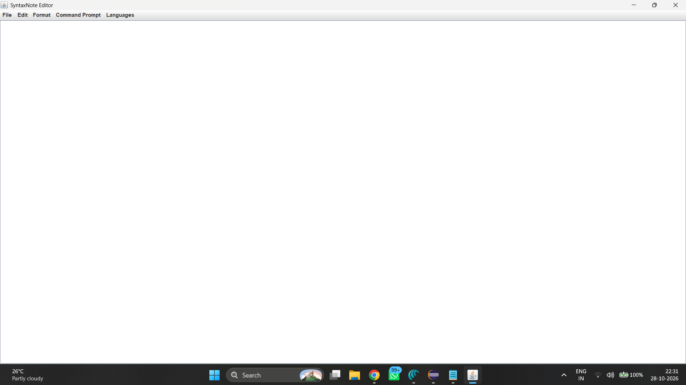
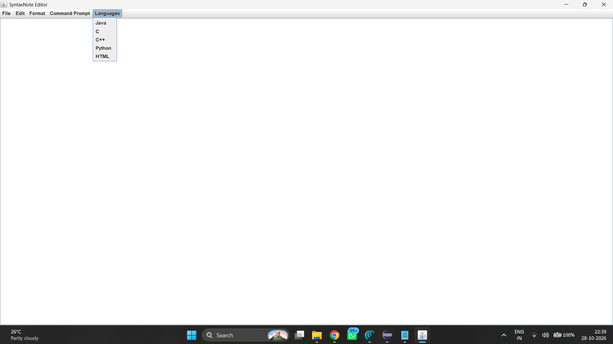
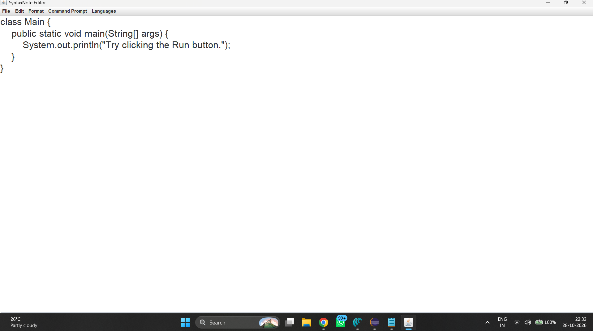

# SyntaxNote – Java Text Editor

SyntaxNote is a simple desktop text editor developed using Java Swing and AWT. It provides basic text editing features along with font customization, word wrapping, language-specific code templates, and Command Prompt integration.

## Features

- **Create New File:** Start writing in a new document.
- **Open File:** Open existing files for editing.
- **Save File:** Save changes to your current file.
- **Save As:** Save a document with a new name or location.
- **Font Customization:** Customize the font style and size.
- **Word Wrap:** Improve readability by wrapping long lines of text.
- **Language Templates:** Load starter templates for Java, C, C++, Python, and HTML.
- **Command Prompt Integration:** Access Command Prompt through the application menu.

## Technologies Used

- Java
- Java Swing
- Java AWT
- File Handling
- Eclipse IDE

## Project Structure

- `CodeEditorGUI.java` – Contains the graphical user interface and text editor functionality.
- `CodeEditorDriver.java` – Contains the main method to launch the application.

## How to Run

1. Clone or download this repository.
2. Open Eclipse IDE.
3. Import the project into your workspace.
4. Ensure the Java Development Kit (JDK) is configured.
5. Locate `CodeEditorDriver.java`.
6. Right-click the file and select **Run As → Java Application**.

## Learning Outcomes

This project helped me practice Java desktop application development, event handling, GUI design, file handling, and working with menus and text components.

## Developer

**Akanksha Surve**

GitHub: https://github.com/akankshasurve7

## Screenshots

Here are some screenshots of the SyntaxNote application.

